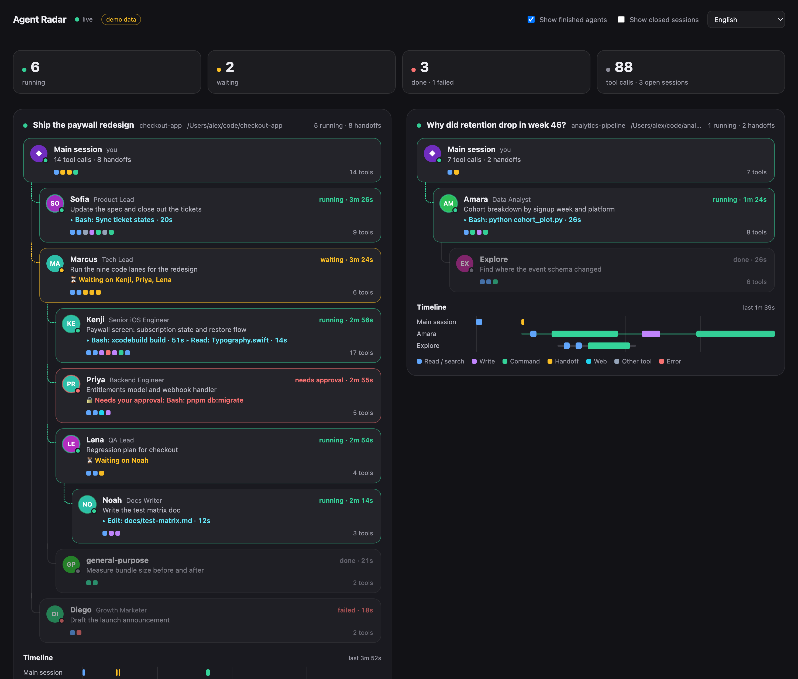
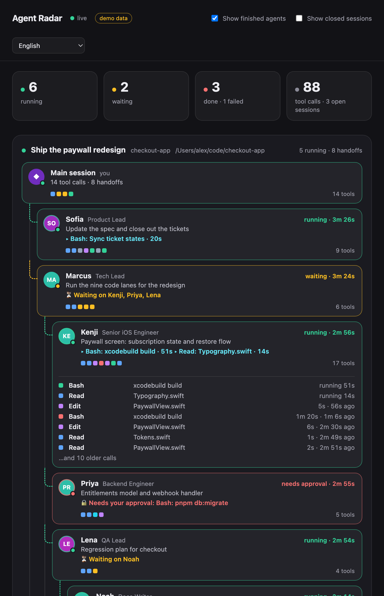
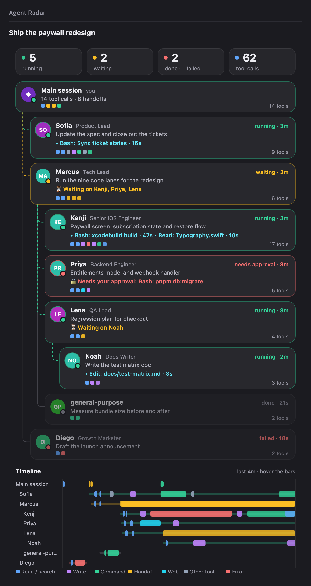
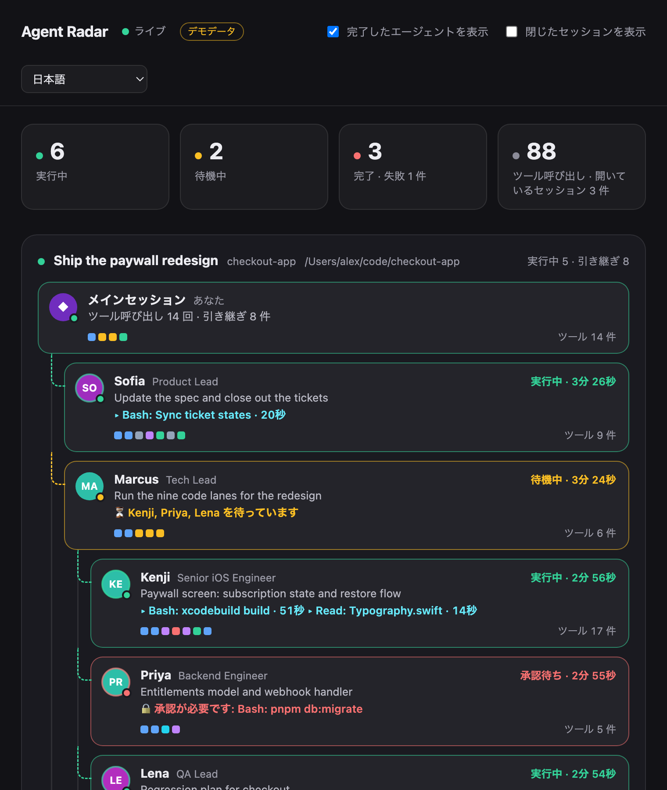
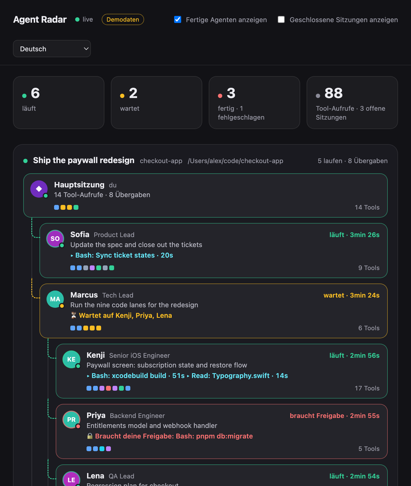

# Agent Radar

**See what your Claude Code agents are actually doing.**

When one agent hands work to another, and that one hands it to three more, the
transcript stops telling you what is going on. Agent Radar shows it: who gave
work to whom, what each agent is doing this second, what it is waiting on, and
every tool call on a timeline.



It is a Claude Code plugin with two views fed by the same data:

- **A pane inside Claude Code** for the session you are in.
- **A local web page** that shows every open session on one screen, ticking
  live. Put it on a second monitor and leave it there.

## What you see

| | |
|---|---|
| **Handoff tree** | Each agent is a card, indented under the agent that started it and joined to it by a line. Nested delegation reads at a glance. |
| **What it is doing now** | `▸ Bash: xcodebuild build · 51s`, or `Thinking (no tool in use)`. Several tools in flight show side by side. |
| **What it is waiting on** | `Waiting on Kenji, Priya, Lena`, `Needs your approval: Bash: pnpm db:migrate`, `Turn finished, waiting for a message`. A stuck agent says why. |
| **Tool strip** | A row of colored squares per agent: read, write, command, handoff, web, error. Hover one for the call and how long it took. |
| **Timeline** | One lane per agent, tool calls as bars over time. You see who was busy, who sat idle, and where the failed build ate a minute. |
| **Tool history** | Click a card (press its button in the pane) for that agent's recent calls, newest first. |
| **Session name** | Each session leads with its own title, then its project folder. |
| **Tabs** | One tab per open session plus **All**. A tab shows one session alone; sessions keep a fixed order, so the page does not jump as they update. |

<p>
  
  
</p>

## Languages

The interface ships in 14 languages: English, Türkçe, Deutsch, Español,
Français, Italiano, 日本語, 한국어, Nederlands, Polski, Português (Brasil),
Русский, Svenska, 简体中文.

- The web page follows your browser's language and has a picker in the header.
- The pane follows your shell locale (`LANG`); set `AGENT_RADAR_LANG=de` to
  choose another.

Agent names, task descriptions and tool arguments are shown as they are. Adding
a language is one JSON file: copy `i18n/en.json`, translate the values, run
`node scripts/build-i18n.mjs`. The script refuses a file with a missing key or
a changed placeholder.

<p>
  
  
</p>

## Install

Agent Radar is a function-hooks plugin (a hooks module, `hooks/register.tsx`).
That plugin API is in early access, so it needs a Claude Code build that loads
hooks modules; on a build that does not, the plugin installs but does nothing.
The web page needs Node 18 or newer on your `PATH`.

At the prompt of a terminal session:

```
/plugin install agent-radar --marketplace batuhanyksl1/agent-radar
```

From a shell:

```
claude plugin install agent-radar --marketplace batuhanyksl1/agent-radar
```

In the desktop app: click + next to the prompt box, then Plugins, Add
marketplace with `batuhanyksl1/agent-radar`, then Add plugin.

## Use

| Command | What it does |
|---|---|
| `/radar` | Opens the pane. It also opens by itself when a session starts. |
| `/radar-web` | Starts the local server if it is not running and opens `http://127.0.0.1:4747`. |

The pane redraws when something happens: an agent starts, calls a tool,
finishes, or changes state. The web page refreshes every second, so its timers
count up continuously.

### Try it without a session

```
node web/server.mjs
```

Then open `http://127.0.0.1:4747/?demo` for sample sessions.

## Naming your agents

Agent Radar reads the agent definitions in `~/.claude/agents` and in the
project's `.claude/agents`. Any agent works. If a definition's description
starts with `Name — Role, Team.`, the card shows a name, a role and a
team-colored avatar:

```markdown
---
name: kenji
description: "Kenji — Senior iOS Engineer, Engineering. Use for Swift and SwiftUI work."
---
```

Otherwise the card shows the agent's own name and the first sentence of its
description. A `team:` line in the frontmatter also sets the team.

## How it works

```
Claude Code session ──(plugin hooks)──▶ session state ──▶ pane (SVG, in the app)
                                             │
                                             ▼
                         ~/.claude/agent-radar/state/<session>.json
                                             │
                                             ▼
                          web/server.mjs (127.0.0.1) ──▶ web page
```

- The plugin listens to `agent.spawn` (who started whom), `tool.call` (what
  runs, for how long, whether it failed) and `classic.PermissionRequest` (a call held for your
  approval), and polls the agent list every 3 seconds for status changes.
- The pane is one SVG drawn from that state. Its motion (the pulse on a running
  agent, the flow along a live handoff) is SMIL, so nothing redraws on a timer.
- Each session writes its state to a small JSON file. The server reads those
  files; the page polls the server.

## Privacy

Everything stays on your machine. The server listens on `127.0.0.1` only and
makes no outbound requests.

The state files hold short summaries of tool calls: command descriptions, file
paths, search patterns, the first prompt of a session as its fallback title.
They do not hold file contents or tool output. Files older than 7 days are
deleted; a session silent for 45 seconds is shown as closed. The server exits
after 12 hours without a request.

## Limits

- The pane shows the current session only; the web page shows all of them.
- Cards in the pane are a drawing and cannot be clicked. The buttons under it
  open an agent's history. In the web page the cards themselves are clickable.
- Durations in the pane update when the next event arrives, not every second.
- The last 40 tool calls per agent are kept; older ones are counted.
- A terminal session draws the same information as a text tree, without the
  drawing.
- Right-to-left languages are not supported yet.
- `/radar-web` opens the browser with `open` (macOS). Elsewhere set
  `AGENT_RADAR_OPEN=xdg-open`, or open the address yourself.

## Develop

```
claude --plugin-dir .          # load the plugin from this folder
claude plugin validate .       # what the engine would refuse
claude plugin test .           # tests/radar.test.tsx
node scripts/build-i18n.mjs    # after editing i18n/*.json
```

| Path | What it is |
|---|---|
| `hooks/register.tsx` | The hooks module: events in, state out, the pane |
| `hooks/scene.ts` | The pane's SVG |
| `hooks/lib.ts` | Shared logic: the tree, status, "what is it doing now" |
| `web/` | The server, the page, demo data, the generated `i18n.js` |
| `i18n/` | One JSON file per language |

Forks and pull requests are welcome.

## License

MIT
